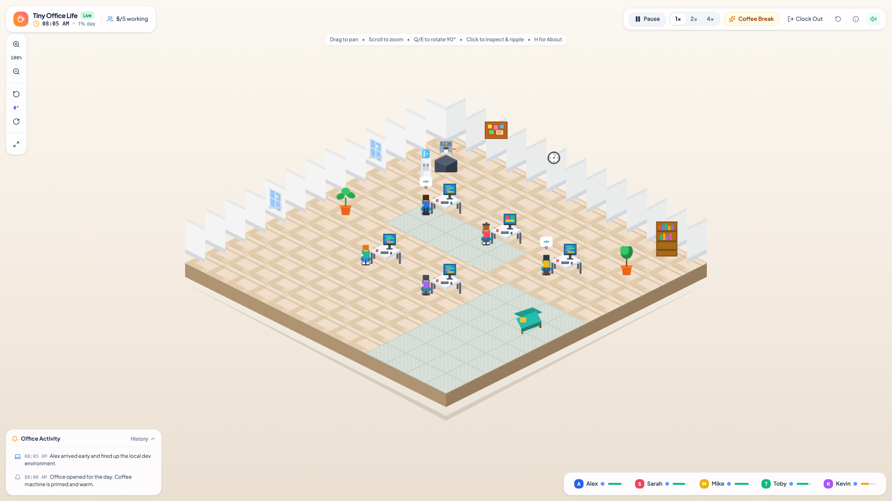
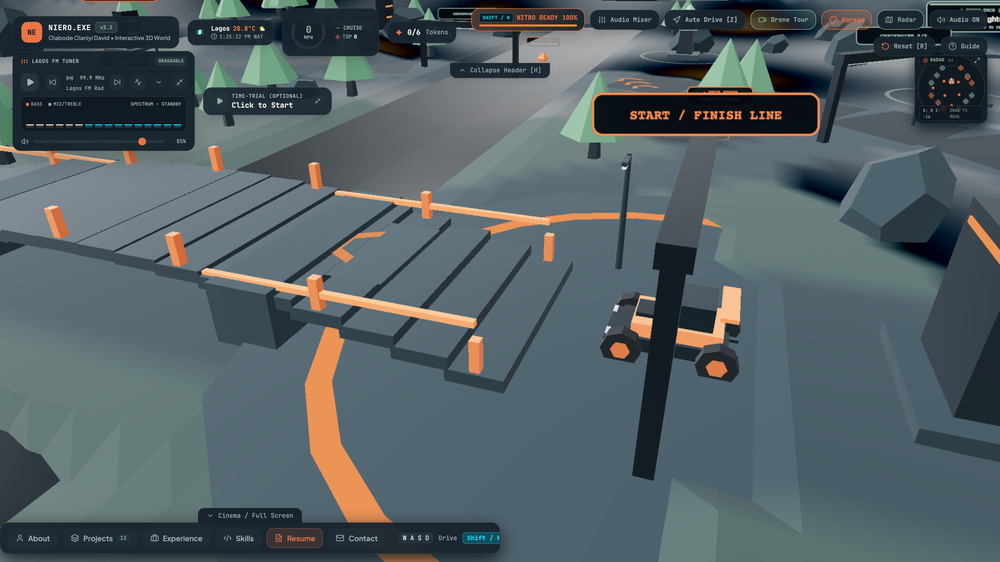
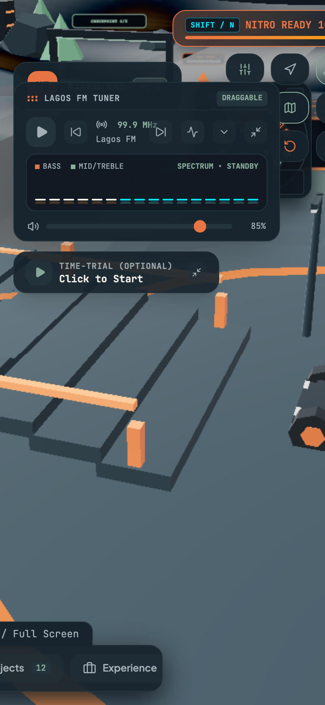
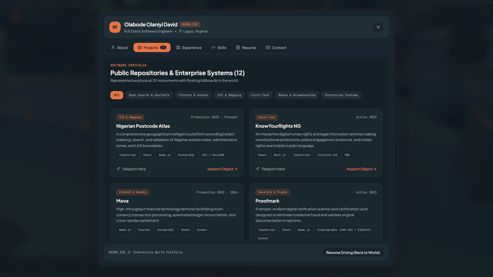
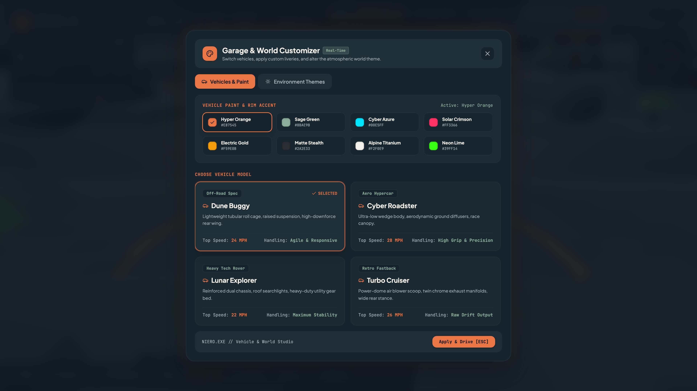
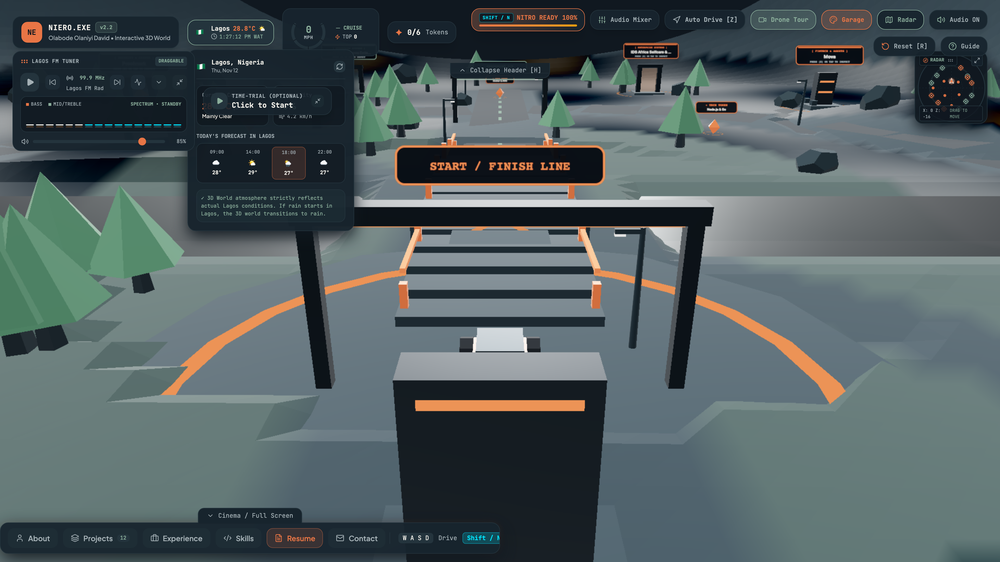

# NIERO.EXE — Interactive 3D World Portfolio

[](CHANGELOG.md)
[](LICENSE)
[](https://react.dev)
[](https://www.typescriptlang.org)
[](https://threejs.org)
[](https://vitejs.dev)
[](https://tailwindcss.com)

> **An interactive low-poly 3D world portfolio where visitors drive a customizable vehicle through a stylized landscape to discover projects, experience, and skills.**

🌐 **Live Demo:** [https://nieroexe.vercel.app](https://nieroexe.vercel.app)  
📄 **Resume:** [View PDF](./public/assets/resume/Olaniyi_Olabode_David_dbf0b21e.pdf)  
👨‍💻 **Developer:** [Olabode Olaniyi David](https://github.com/nierowheezy) | [LinkedIn](https://www.linkedin.com/in/olabode-olaniyi-david)

---

## 🎮 Experience the Portfolio

### **Drive & Explore**
Take control of a fully physics-simulated vehicle and freely explore a 160×160 unit low-poly world complete with roads, a river canal, arched bridge, and mountain boundaries.

### **12 Unique Thematic Landmarks**
Each project is represented by a **distinct 3D object** — not generic buildings:
| Project | Landmark | Visual Metaphor |
|---------|----------|-----------------|
| Nigerian Postcode Atlas | 🌍 Globe | Miniature geographic globe with coordinate rings |
| KnowYourRights NG | 🏛️ Kiosk | Digital civic info terminal with interactive screen |
| Mova / Xfund | 💻 Terminal | Fintech transaction monolith with LED data slits |
| Proofmark | 🔐 Vault | Cryptographic vault with rotating diamond scanner |
| use-dark-switch | 🔘 Switch | Physical toggle monolith with floating mode sphere |
| SQL Cheatsheet | 📐 Monolith | Database query obelisk with glowing data ring |
| Channels TV | 📡 Tower | Broadcasting antenna with satellite dish |
| IDS Africa / ALAT | 🚪 Gateway | Enterprise transaction arch with energy beam |
| GitHub Badges | 🏆 Badge | Trophy pedestal with floating GitHub star |

### **Screenshots**

<table>
<tr>
<td align="center"><strong>Dashboard View</strong></td>
<td align="center"><strong>Driving View</strong></td>
</tr>
<tr>
<td></td>
<td></td>
</tr>
<tr>
<td align="center"><strong>Mobile View</strong></td>
<td align="center"><strong>Portfolio Modal</strong></td>
</tr>
<tr>
<td></td>
<td></td>
</tr>
<tr>
<td align="center"><strong>Vehicle Customizer</strong></td>
<td align="center"><strong>Lagos Weather Sync</strong></td>
</tr>
<tr>
<td></td>
<td></td>
</tr>
</table>

---

## ✨ Key Features

### 🌍 **Real-Time Lagos Weather Sync**
The 3D world's atmosphere **strictly mirrors actual conditions in Lagos, Nigeria** — powered by [Open-Meteo](https://open-meteo.com/).
- ☀️ Sunny → Clear skies, warm lighting
- ☁️ Overcast → Dimmed lighting, cloud cover
- 🌧️ Rain → Dynamic rain streaks, wet surfaces, thunderstorm lighting
- 📊 Hourly forecast dropdown (Morning, Afternoon, Evening, Night)
- 🔄 Auto-refresh every 5 minutes + manual refresh
- 🕐 Live West Africa Time (WAT) clock

### 🚗 **4 Drivable Vehicle Models**
| Model | Category | Top Speed | Handling |
|-------|----------|-----------|----------|
| **Dune Buggy** | Off-Road Spec | 24 MPH | Agile & Responsive |
| **Cyber Roadster** | Aero Hypercar | 28 MPH | High Grip & Precision |
| **Lunar Explorer** | Heavy Tech Rover | 22 MPH | Maximum Stability |
| **Turbo Cruiser** | Retro Fastback | 26 MPH | Raw Drift Output |

- 8 custom paint colors with live preview
- Realistic physics: Ackermann steering, suspension lean, drift mechanics
- Nitro boost with charge/drain system (Shift/N key)

### 🏁 **Gameplay Modes**
- **Free Roam** — Explore at your own pace
- **Time-Trial Race** — 8-checkpoint circuit with lap timing & leaderboards
- **Cinematic Drone Tour** — Auto-flying showcase through all landmarks
- **Auto-Drive** — Autonomous cruise between all 12 projects (Z key)

### 🏆 **Collectibles & Achievements**
- **6 Tech Tokens** hidden across the world (TypeScript, React/Three.js, Node.js, PostgreSQL/Redis, Docker/AWS, WebSockets)
- **8 Achievements**: Speed Demon, Drift Master, First Ignition, Master Explorer, Tech Collector, Nitro Overdrive, Lap Record, Overlook Master

### 🎨 **5 World Themes** (Instant Palette Swap)
| Theme | Palette | Vibe |
|-------|---------|------|
| **Obsidian Twilight** | Dark navy, sage, amber | Default dark-mode |
| **Sahara Sunset** | Terracotta, warm reds | Dusk red planet |
| **Emerald Aurora** | Arctic jade, mint | Sci-fi highlands |
| **Deep Oceanic** | Midnight blues, cyan | Nautical depths |
| **Synthwave Noir** | Cyberpunk purple, neon | High-contrast retro |

### 📱 **Full Portfolio Modal**
6 comprehensive tabs accessible from the bottom dock:
1. **About** — Bio, stats, education
2. **Projects** — 12 projects with descriptions, tech stacks, GitHub links
3. **Experience** — 8 roles across Channels TV, iTap Solutions, Desygner, Wema Bank, etc.
4. **Skills** — 6 categories, 24+ technologies
5. **Resume** — Direct PDF download
6. **Contact** — Email, phone, GitHub, LinkedIn

### 🔊 **Procedural Audio (Zero Audio Files)**
Web Audio API synthesis for:
- Engine RPM-based pitch
- Wind velocity scaling
- Nitro boost roar
- Brake squeal
- UI interactions (clicks, checkpoints, token collection)

---

## 🛠️ Tech Stack

| Category | Technologies |
|----------|--------------|
| **Frontend** | React 19, TypeScript 5, Vite 6 |
| **3D Engine** | Three.js r187 (custom game loop) |
| **Styling** | Tailwind CSS v4, CSS Modules |
| **Animation** | Framer Motion (Motion) |
| **Icons** | Lucide React |
| **Audio** | Web Audio API (procedural synthesis) |
| **Weather API** | Open-Meteo (Lagos: 6.5244, 3.3792) |
| **Deployment** | Vercel (static) |
| **Package Manager** | npm |

---

## 🚀 Getting Started

### Prerequisites
- Node.js 18+
- npm 9+

### Installation

```bash
# Clone the repository
git clone https://github.com/nierowheezy/nieroexe.git
cd nieroexe

# Install dependencies
npm install

# Start development server (http://localhost:3000)
npm run dev
```

### Available Scripts

```bash
npm run dev       # Start dev server on port 3000
npm run build     # Production build to dist/
npm run preview   # Preview production build
npm run lint      # TypeScript type check
npm run clean     # Remove dist/ and build artifacts
```

---

## 🎮 Controls

| Input | Action |
|-------|--------|
| `W` / `↑` | Accelerate |
| `S` / `↓` | Brake / Reverse |
| `A` / `←` | Steer Left |
| `D` / `→` | Steer Right |
| `Space` | Handbrake |
| `Shift` / `N` | **Nitro Boost** |
| `Z` | Toggle **Auto-Drive** |
| `R` | Reset Vehicle to Road |
| `E` | Interact with Landmark |
| `H` | Toggle Header Bar |
| `Mouse Drag` | Orbit Camera |
| `Scroll` | Zoom Camera |

### Mobile
On-screen touch controls appear automatically on touch devices (iOS Safari, Chrome Android).

---

## 📦 Project Structure

```
nieroexe/
├── public/
│   └── assets/
│       └── resume/
│           └── Olaniyi_Olabode_David_dbf0b21e.pdf
├── src/
│   ├── components/           # React UI components
│   │   ├── HUD.tsx           # Main overlay (header, minimap, dock, proximity banner)
│   │   ├── ProjectModal.tsx  # Single project detail view
│   │   ├── PortfolioModal.tsx# Full 6-tab portfolio
│   │   ├── CustomizerModal.tsx# Vehicle & theme customizer
│   │   ├── Minimap.tsx       # Radar with teleport & project select
│   │   ├── SpeedometerGauge.tsx# Circular digital speedometer
│   │   ├── RaceTimerHUD.tsx  # Race timing & checkpoints
│   │   ├── RadioWidget.tsx   # Lagos-themed radio widget
│   │   ├── TourOverlay.tsx   # Drone tour / auto-drive banner
│   │   ├── AudioSettingsModal.tsx# Audio mixer
│   │   └── ...
│   ├── data/
│   │   └── portfolioData.ts  # Projects, experience, skills, tokens
│   ├── game/                 # Core 3D engine (Three.js)
│   │   ├── engine.ts         # Main orchestrator (render loop, input, callbacks)
│   │   ├── vehicle.ts        # Physics, 4 models, nitro, dust, suspension
│   │   ├── terrain.ts        # Procedural heightmap, roads, river, bridge
│   │   ├── landmarks.ts      # 12 thematic landmarks + 6 tokens
│   │   ├── camera.ts         # Chase cam, orbit, inspect, cinematic
│   │   ├── weather.ts        # Rain, overcast, sunny + particle streaks
│   │   ├── race.ts           # Time-trial circuit, checkpoints, laps
│   │   ├── tour.ts           # Cinematic drone tour system
│   │   ├── autodrive.ts      # Autonomous pathfinding between landmarks
│   │   ├── audio.ts          # Web Audio synthesis (engine, wind, SFX)
│   │   ├── environment.ts    # Procedural trees, rocks, ambient
│   │   ├── nitroParticles.ts # 3D trailing nitro particle system
│   │   └── constants.ts      # Palette, configs, themes, vehicle specs
│   ├── services/
│   │   └── lagosWeather.ts   # Open-Meteo integration + WAT clock
│   ├── App.tsx               # Root component, state, callbacks
│   ├── main.tsx              # Entry point
│   └── index.css             # Global styles, Tailwind imports
├── docs/                     # Screenshots for README
├── .github/
│   └── workflows/
│       └── deploy.yml        # Vercel deployment workflow
├── CHANGELOG.md              # Version history
├── vercel.json               # Vercel config (SPA routing, caching)
├── vite.config.ts            # Vite + Tailwind + React config
├── tsconfig.json             # TypeScript config
├── package.json
└── README.md
```

---

## 🌐 Deployment

### Vercel (Recommended)

[](https://vercel.com/new/clone?repository-url=https://github.com/nierowheezy/nieroexe)

1. Push to GitHub
2. Import project in [Vercel Dashboard](https://vercel.com/dashboard)
3. Framework Preset: **Vite**
4. Build Command: `npm run build`
5. Output Directory: `dist`
6. Deploy

The included `vercel.json` handles:
- SPA routing (all routes → `index.html`)
- Asset caching (1 year for `/assets/*`)
- Clean URLs

### Custom Domain
To use a custom domain:
1. In Vercel Dashboard → Project → Settings → Domains
2. Add your custom domain
3. Configure DNS records as instructed by Vercel

### Other Static Hosts
The `dist/` output is a standard static site. Deploy to:
- Netlify
- Cloudflare Pages
- GitHub Pages
- AWS S3 + CloudFront
- Firebase Hosting

---

## 🔧 Configuration

### Environment Variables
No required environment variables. The weather service uses Open-Meteo's free tier (no API key needed).

### Customization
Edit `src/data/portfolioData.ts` to:
- Update personal info (`DEVELOPER_PROFILE`)
- Add/remove projects (`PROJECTS` array)
- Modify experience entries (`EXPERIENCES`)
- Adjust skill categories (`SKILL_CATEGORIES`)
- Reposition landmarks (`coordinates` in each project)
- Add/remove collectible tokens (`TOKENS`)

Edit `src/game/constants.ts` to:
- Modify color palette (`PALETTE`)
- Adjust vehicle physics (`VEHICLE_CONFIG`)
- Change world bounds (`WORLD_CONFIG`)
- Add new themes (`ENVIRONMENT_THEMES`)
- Add new vehicle models (`VEHICLE_MODELS`, `PAINT_COLORS`)

---

## 📄 License

MIT License — see [LICENSE](LICENSE) for details.

Feel free to use this as inspiration for your own portfolio! Attribution appreciated but not required.

---

## 🙏 Acknowledgments

- **Three.js** community for the incredible 3D engine
- **Open-Meteo** for free weather API
- **Lucide** for beautiful icons
- **Tailwind CSS** for utility-first styling
- **Vite** for lightning-fast builds
- All open-source projects that made this possible

---

## 📞 Contact

**Olabode Olaniyi David**  
📍 Lagos, Nigeria  
✉️ olaniyiolabode99@gmail.com  
📱 +234 815 943 2789  
🐙 [GitHub](https://github.com/nierowheezy)  
💼 [LinkedIn](https://www.linkedin.com/in/olabode-olaniyi-david)

---

<div align="center">
  <sub>Built with ❤️ and TypeScript • v2.2.0 • <a href="CHANGELOG.md">Changelog</a></sub>
</div>